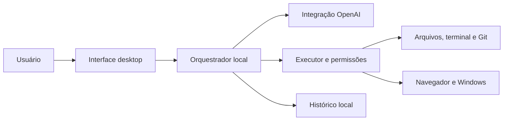

# Arquitetura proposta

## Implementado no MVP (08/11/2026)

Electron + Node.js com frontend HTML/JS, isolamento de contexto e ponte de IPC. O processo principal escolhe entre `Agent` (Responses API com OAuth do plano ChatGPT, sem API key) e `CodexAgent` (SDK Codex/CLI); ambos usam uma pasta de trabalho por vez e exibem eventos na mesma interface. A autenticação de plano ChatGPT é feita no processo principal em `src/chatgpt-auth.cjs`, com tokens criptografados fora do repositório. O executor `src/workspace.cjs` aplica proteções de arquivos para o agente ChatGPT. O Codex usa seu próprio sandbox `workspace-write`, autorizado por tarefa. As seções abaixo preservam a visão de arquitetura de longo prazo.

Estado: proposta técnica, sem implementação ou validação de dependências. Escolhas reversíveis podem ser ajustadas após inspeção do repositório.

## Escolha inicial

Avaliar Electron com TypeScript e uma interface React para uma base nova: facilita compartilhar tipos entre interface e ferramentas locais. O custo é maior consumo de memória e a necessidade de isolar rigorosamente a interface. Comparar com Tauri caso tamanho e consumo sejam restrições dominantes, considerando o custo de manter a integração nativa. Preservar uma base desktop válida já existente. Não iniciar migração nem impor Next.js sem necessidade.

Confirmar versões e práticas de isolamento nas documentações oficiais antes de codificar. Não carregar páginas externas com privilégios locais.

## Responsabilidades

- Interface: chat com streaming, projetos, editor, terminal, revisão de diferenças e configurações.
- Orquestrador local: contexto, chamadas ao modelo, ciclo de ferramentas, estado da tarefa e cancelamento.
- Executor local: validação de argumentos, aplicação de permissões e execução de arquivos, processos e Git.
- Adaptador OpenAI: autenticação suportada, streaming, chamadas de ferramentas, erros e uso reportado.
- Persistência: conversas, projetos, tarefas e ações em armazenamento local; avaliar SQLite. Segredos ficam em mecanismo protegido do sistema, fora do banco de conversas.
- Navegador: automação em sessão identificável e gestão explícita de perfis; avaliar Playwright antes de implementar.
- Controle do Windows: módulo separado para captura de tela e interação acessível, com interrupção visível e testes em aplicativo de exemplo.
- MCP: extensão posterior por servidores cadastrados, com permissões por ferramenta e ciclo de vida dos processos.

## Contratos mínimos

Uma tarefa tem id, projeto, solicitação, estado, início e término. Uma ação tem id, taskId, ferramenta, argumentos redigidos para exibição, estado, resultado ou erro. Estados de tarefa: preparada, executando, aguardando decisão, concluída, falhou e cancelada; validar transições no orquestrador.

Cada ferramenta declara nome, esquema de entrada, descrição de efeitos e função executora. O executor valida argumentos e autorização antes de agir e retorna resultado estruturado com saída truncada quando necessário. Nunca confiar apenas no pedido de permissão formulado pelo modelo.

Ferramentas iniciais: listar e ler arquivos, aplicar alterações, iniciar e consultar processo, encerrar processo da tarefa, consultar status e diff do Git. Validar diretórios de trabalho, caminhos Windows, Unicode, espaços, links e junctions. Comandos livres podem escapar de restrições de pastas; só oferecer execução arbitrária em um modo compatível com esse poder ou estabelecer isolamento real.

## Ciclo do agente

Receber pedido → selecionar contexto → chamar modelo → validar chamada de ferramenta → autorizar conforme política → executar → devolver resultado ao modelo → repetir até conclusão, interrupção ou erro. Implementar limites técnicos configuráveis contra ciclos, tempo e saída excessiva; documentar quando forem atingidos.

Evitar enviar todo o disco ao modelo. Buscar arquivos relevantes e resumir contexto com referências rastreáveis. Registrar decisões duráveis no projeto sem prometer memória automática fora do armazenamento implementado.

## Falhas e proteção

Tratar falha de rede, credencial inválida, limite de serviço, indisponibilidade de modelo, arquivo bloqueado, conflito de edição, processo travado e Git ausente. Repetir automaticamente apenas ações adequadas à repetição. Distinguir timeout de execução que ainda pode estar ativa.

O modo completo não equivale a elevar privilégios no Windows. Não habilitar execução remota nem abrir serviços em rede por conveniência. Se houver serviço local, autenticar e limitar sua exposição. Conteúdo externo não pode alterar permissões ou obter segredos.

## Fontes a validar na implementação

Documentação oficial da OpenAI para modelos, autenticação, API e ferramentas; Electron ou Tauri para isolamento e distribuição; Microsoft para credenciais e automação Windows; Git e Playwright para operações adotadas. Registrar URLs, data e decisão após consulta. Este documento não fixa contratos de API não verificados.
